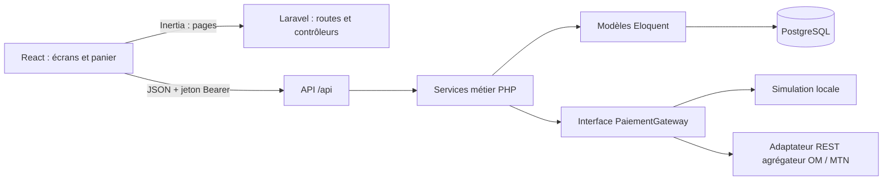

# Architecture du backend Mon Miam Miam

## Le principe à retenir pour la soutenance

Laravel reçoit les pages web et les affiche avec **Inertia.js + React**. Les données et actions métier passent par une **API JSON Laravel** sous `/api`. Le navigateur ne dialogue jamais directement avec PostgreSQL ni avec Orange/MTN.

Le choix est volontairement facile à présenter : **une route → un contrôleur → un service métier → un modèle → PostgreSQL**. Le contrôleur traduit HTTP en appel métier; le service contient les règles; le modèle décrit l'accès aux données. Les migrations gardent les règles d'intégrité proches des tables.

## Pourquoi Inertia et une API à la fois ?

- **Inertia** sert l'application React dans le même projet Laravel. La route web renvoie une page React; les écrans et styles existants restent dans `frontend/`.
- **L'API JSON** transporte les comptes, menus, commandes et paiements. Elle est utilisable par le navigateur et par un futur autre client.
- Les appels du navigateur utilisent un jeton Bearer haché en base; les routes privées vérifient aussi le rôle.
- Le retour d'un agrégateur de paiement est une route API serveur-à-serveur. Il ne dépend pas d'une page React.

Le frontend garde React Router pour ses URL actuelles. Laravel/Inertia fournit la page d'entrée et répond aussi aux rechargements d'URL; l'API reste le contrat de données. Cela permet de relier le projet sans réécrire toute la maquette.

## POO et modularisation

| Élément | Exemple | Responsabilité |
|---|---|---|
| Modèle | `Commande`, `Etudiant`, `Paiement` | Table, relations et représentation des données |
| Form Request | `CommandeRequest` | Validation des champs entrants |
| Contrôleur | `CommandeController`, `PaiementController` | Routes HTTP et codes de réponse |
| Service | `CommandeService`, `PaiementService`, `PointsService` | Calculs et règles métier réutilisables |
| Interface | `PaiementGateway` | Contrat commun aux fournisseurs de paiement |
| Adaptateur | `PaiementSimuleGateway`, `PaiementAgregateurGateway` | Détail technique du simulateur ou de l'agrégateur |
| Middleware | `VerifierRole`, `HandleInertiaRequests` | Contrôle transversal avant les contrôleurs |

Exemple à expliquer : `PaiementController` valide les informations du formulaire; `PaiementService` crée un paiement et déclenche les points après une notification valide; `PaiementGateway` permet de changer de simulateur à agrégateur sans placer les règles de fidélité dans le contrôleur.

## Les neuf étapes

1. **Base** : migrations PostgreSQL ordonnées, clés étrangères, index et `CHECK`; rôles, catégories, restaurant et paramètres chargés par `ReferenceSeeder`.
2. **Comptes** : quatre rôles, inscription étudiant avec parrainage, connexion, déconnexion, profil et réinitialisation.
3. **Catalogue** : menu public, catégories, promotions, gestion des articles et disponibilités.
4. **Commandes** : devis, création, commentaire cuisine, points, statuts, journal historique et suivi.
5. **Paiements** : initiation Orange Money/MTN MoMo, identifiant d'idempotence, notification signée, simulation locale, points à la confirmation et parrainage au premier paiement réussi.
6. **Réclamations** : dépôt étudiant, réponse du personnel, décision du gérant, avec transitions contrôlées.
7. **Événements et jeux** : liste, participation une seule fois, question liée à une session courte, réponse vérifiée côté serveur, crédit de points et classement.
8. **Administration** : indicateurs, équipe, règles de fidélité et étudiants ayant commandé dans un restaurant.
9. **Tests, sécurité et intégration** : tests Feature Laravel, validation, rôles, limites de requêtes, API Bearer, documentation et React/Inertia.

## Paiements : ce qui fonctionne aujourd'hui

Par défaut, `.env` configure `MOBILE_MONEY_MODE=simulation`. La simulation n'envoie **aucun vrai paiement** : après l'initiation, l'environnement local peut confirmer le paiement par `/api/paiements/{id}/simulation`. Cela permet d'essayer les commandes et points.

`PaiementAgregateurGateway` illustre le contrat REST générique choisi. Pour encaisser réellement, il faudra les identifiants marchand, l'URL et la documentation exacte de l'agrégateur retenu; son format de signature et ses routes doivent être alignés sur ce contrat avant activation. Ne mettez pas de secrets dans React, Git ou `.env.example`.

## Sources du plan

Le plan en neuf étapes joint au projet est une feuille de route de travail. Il ne remplace pas le cahier des charges fonctionnel; les décisions d'implémentation sont résumées ici et dans `docs/03-technique/api/API_Backend_Mon_Miam_Miam.md`.
