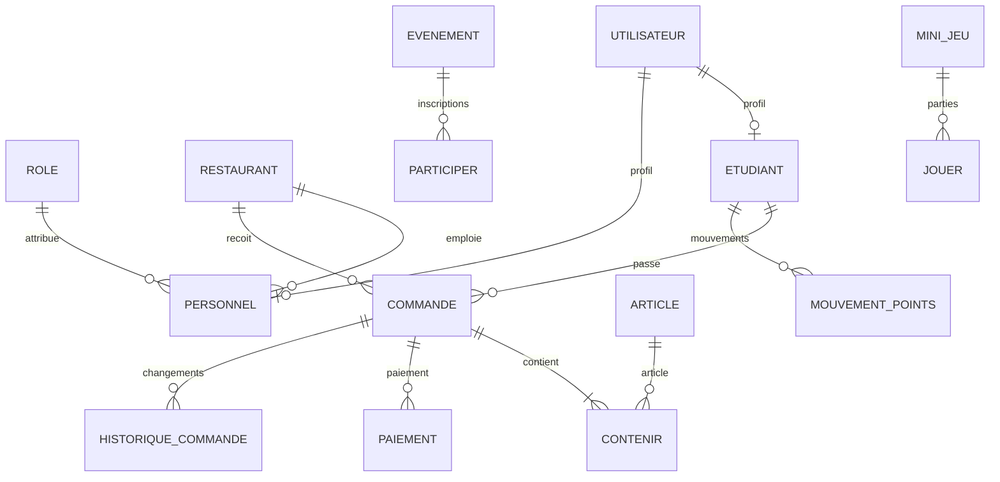

# Migrations et modèle PostgreSQL — Mon Miam Miam

## Réponse courte : y a-t-il assez de migrations ?

Le dépôt contient **31 fichiers de migration** :

- **3 migrations Laravel génériques** (`users`, `cache`, `jobs`), fournies par le squelette. `users` n'est pas la table métier utilisée pour la connexion Mon Miam Miam ; l'application utilise `utilisateur` et ses profils. `cache` et `jobs` servent aux pilotes Laravel configurés sur base de données.
- **25 migrations métier initiales** numérotées `2026_10_18_000001` à `2026_10_18_000025`.
- **3 migrations d'évolution** numérotées `2026_10_20_000001` à `2026_10_20_000003` (agrégateur de paiement, contraintes de paiement, session sécurisée de mini-jeu).

Pour les fonctions prévues dans le backend actuel, le modèle couvre comptes, rôles, restaurant, étudiants et parrainage, catalogue, menu, promotions, commandes et lignes, paiements, fidélité, réclamations, événements, mini-jeux, jetons, consentements et historique. Cela constitue une base cohérente pour le périmètre des neuf étapes.

**Attention :** le nombre de fichiers ne confirme pas que ces migrations ont été exécutées sur votre serveur. Il faut vérifier `php artisan migrate:status` sur votre machine. Les tests lancés pendant la préparation n'ont pas pu se connecter à PostgreSQL car l'environnement PHP de cette session n'avait pas le pilote `pdo_pgsql`.

## Inventaire des migrations

| N° | Migration | Table(s) / rôle |
|---:|---|---|
| 1 | `2026_10_18_000001_create_role_table` | `role`, les rôles du personnel |
| 2 | `2026_10_18_000002_create_restaurant_table` | `restaurant` |
| 3 | `2026_10_18_000003_create_utilisateur_table` | `utilisateur`, identité et accès communs |
| 4 | `2026_10_18_000004_create_etudiant_table` | `etudiant`, points, code de parrainage, filleul |
| 5 | `2026_10_18_000005_create_personnel_table` | `personnel`, rôle, restaurant, créateur |
| 6 | `2026_10_18_000006_create_parametre_table` | `parametre`, règles de fidélité par restaurant |
| 7 | `2026_10_18_000007_create_categorie_table` | `categorie` |
| 8 | `2026_10_18_000008_create_article_table` | `article`, prix, disponibilité, catégorie et restaurant |
| 9 | `2026_10_18_000009_create_menu_jour_table` | `menu_jour`, un menu par restaurant et date |
| 10 | `2026_10_18_000010_create_composer_table` | `composer`, articles présents au menu |
| 11 | `2026_10_18_000011_create_promotion_table` | `promotion`, taux et période |
| 12 | `2026_10_18_000012_create_commande_table` | `commande`, client, restaurant, mode de service, totaux et statut |
| 13 | `2026_10_18_000013_create_contenir_table` | `contenir`, lignes de commande et prix figé |
| 14 | `2026_10_18_000014_create_paiement_table` | `paiement` initial |
| 15 | `2026_10_18_000015_create_mouvement_points_table` | `mouvement_points`, grand livre de fidélité |
| 16 | `2026_10_18_000016_create_reclamation_table` | `reclamation`, réponse et décision |
| 17 | `2026_10_18_000017_create_evenement_table` | `evenement` |
| 18 | `2026_10_18_000018_create_participer_table` | `participer`, participation étudiant/événement |
| 19 | `2026_10_18_000019_create_mini_jeu_table` | `mini_jeu` |
| 20 | `2026_10_18_000020_create_jouer_table` | `jouer`, résultat d'une partie |
| 21 | `2026_10_18_000021_create_jeton_mdp_table` | `jeton_mdp`, réinitialisation de mot de passe |
| 22 | `2026_10_18_000022_create_consentement_table` | `consentement`, consentement applicatif enregistré en base |
| 23 | `2026_10_18_000023_create_jeton_acces_table` | `jeton_acces`, jetons Bearer hachés |
| 24 | `2026_10_18_000024_create_concerner_table` | `concerner`, association promotions/articles |
| 25 | `2026_10_18_000025_create_historique_commande_table` | `historique_commande`, journal des changements de statut |
| 26 | `2026_10_20_000001_extend_paiement_for_aggregator` | Ajoute à `paiement` les informations du fournisseur et d'idempotence |
| 27 | `2026_10_20_000002_add_payment_constraints` | Contraintes d'intégrité et unicité d'un paiement en attente |
| 28 | `2026_10_20_000003_create_session_mini_jeu_table` | `session_mini_jeu`, question/réponse à usage unique et expiration |

Cette table numérote seulement les migrations métier (28). Les trois migrations Laravel génériques — `0001_01_01_000000_create_users_table.php`, `0001_01_01_000001_create_cache_table.php` et `0001_01_01_000002_create_jobs_table.php` — portent le total global à **31**.

## Relations principales



Les clés étrangères sont explicites. Les suppressions sont généralement restreintes pour conserver l'historique comptable; quelques tables d'association ou sessions temporaires utilisent `cascadeOnDelete`. Le compte supprimé est anonymisé dans le contrôleur afin de préserver les commandes et paiements associés.

Les trois migrations Laravel génériques créent huit tables techniques : `users`, `password_reset_tokens`, `sessions`, `cache`, `cache_locks`, `jobs`, `job_batches` et `failed_jobs`. Plusieurs sont inutilisées par les flux applicatifs actuels (notamment `users` et `password_reset_tokens`, car l'authentification MMM utilise `utilisateur`/`jeton_mdp`); elles viennent du squelette Laravel. `cache`/`jobs` sont disponibles si les pilotes de cache/queue de `.env` les utilisent.

## Contraintes de données importantes

Les contraintes `CHECK` documentées dans les migrations incluent notamment :

- nom utilisateur non vide après suppression des espaces;
- solde étudiant jamais négatif, parrain différent du filleul et cohérence entre parrain et date de parrainage;
- prix d'article strictement positif;
- promotion entre 0 et 100 %, date de fin au moins égale à la date de début;
- quantités et prix figés de ligne de commande positifs;
- montants et points de commande positifs ou nuls; cohérence des champs selon `sur_place` ou `livraison`;
- mouvement de points non nul et cohérent avec le type d'opération;
- montant payé positif, taux/date de promotion valides, scores/récompenses non négatifs;
- clé d'idempotence unique et une seule transaction de paiement en attente par commande selon la contrainte partielle.

Les index/uniques importants protègent aussi les emails, codes de parrainage, matricules, associations menu/article, participation étudiant/événement et clés d'idempotence. Les services PHP contrôlent les règles métier plus fines (ordre des statuts, solde disponible, paiement confirmé), que les contraintes SQL seules ne peuvent pas exprimer proprement.

## Domaines PostgreSQL, vues et triggers

Dans l'état actuel, le projet **ne déclare pas de types PostgreSQL `CREATE DOMAIN`**, **ne crée pas de vues SQL** et **n'installe pas de triggers SQL**. Les fichiers de migration emploient les types Laravel usuels (`string`, `integer`, `boolean`, `date`, `timestamp`, etc.) et ajoutent des contraintes `CHECK`, clés étrangères, uniques et index.

Un `DOMAIN` PostgreSQL est un type réutilisable qui peut porter une contrainte (par exemple un type de téléphone ou un montant positif). Il serait pertinent si plusieurs tables partageaient exactement le même type et la même validation. Ici, la validation est répartie par colonne et les règles évoluent selon le contexte; des `CHECK` nommés sont plus directs à soutenir et évitent une couche de types personnalisés à maintenir dans les migrations Laravel.

Les « vues » présentées dans les écrans sont pour l'instant des routes API qui interrogent les modèles/services, pas des objets `CREATE VIEW`. Aucun trigger n'automatise les points : `PointsService` et `PaiementService` écrivent explicitement les mouvements dans une transaction Laravel. Cette décision garde le déroulé visible dans le code PHP et plus facile à expliquer. On peut ajouter ultérieurement des vues SQL pour les rapports de lecture, ou des triggers si une règle doit rester garantie même quand les écritures ne passent pas par Laravel; ce n'est pas nécessaire pour exécuter le périmètre actuel.

## Ce que le schéma ne modélise pas encore explicitement

La ligne d'une commande conserve article, quantité et prix unitaire, et la commande conserve un commentaire libre (`commentaire_client`). Il n'existe pas encore de tables dédiées aux suppléments/options structurés (choix de frites, quantité de bâtons, options à prix additionnel) ni à la configuration des choix autorisés par article. Tant que la maquette exprime ces préférences uniquement en commentaire ou sous forme d'articles séparés, le schéma permet le parcours; pour calculer et contrôler automatiquement des suppléments, il faudra ajouter par exemple `option_article`, `option_article_prix` et `option_commande` via de nouvelles migrations. Une modification future doit être additive et conserver l'historique de commandes existant.

La bannière cookie du frontend conserve le choix d'affichage dans `localStorage`. La table `consentement` sert au consentement fonctionnel d'un compte lorsque ce flux est utilisé; elle ne rend pas nécessaire le stockage serveur d'un cookie technique du navigateur.

## Ordre de création et vérification

Les noms horodatés assurent l'ordre : tables référencées d'abord, tables dépendantes ensuite, puis les évolutions. Pour vérifier l'état réel sur votre poste :

```powershell
cd backend
php artisan migrate:status
php artisan migrate --pretend
```

`migrate:status` indique `Ran` ou `Pending` pour chaque fichier. `--pretend` affiche le SQL que Laravel prévoit sans appliquer les changements. Après validation et sauvegarde de la base, `php artisan migrate` applique les migrations manquantes.

Pour une base de test jetable seulement, `php artisan migrate:fresh --seed` supprime et recrée toutes ses tables. **Ne lancez jamais cette commande sur la base de démonstration ou une base contenant des données à garder.**

```sql
-- Dans la base active, liste des tables utilisateurs
SELECT schemaname, tablename
FROM pg_tables
WHERE schemaname NOT IN ('pg_catalog', 'information_schema')
ORDER BY schemaname, tablename;

-- Historique Laravel des migrations appliquées
SELECT migration, batch FROM public.migrations ORDER BY batch, migration;
```
