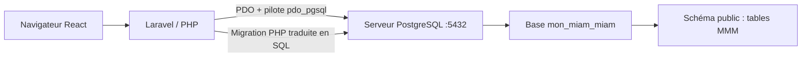

# Démarrer Mon Miam Miam avec PostgreSQL et PHP

Ce document explique concrètement comment lancer PostgreSQL, configurer PHP/Laravel, appliquer les migrations et retrouver les tables dans pgAdmin ou DataGrip.

## 1. Comprendre le trajet d'une donnée



- **PostgreSQL** est le serveur qui stocke les données. Sur Windows il doit être démarré comme service.
- **pgAdmin/DataGrip** sont des interfaces clientes : elles se connectent au serveur et affichent les bases; elles ne démarrent pas à elles seules le serveur.
- **PHP** doit avoir `pdo_pgsql` pour que Laravel ouvre une connexion PostgreSQL.
- **Laravel** lit les paramètres de `backend/.env`, envoie des requêtes SQL au serveur et exécute les migrations.
- **React** parle à Laravel par HTTP. Le navigateur React ne se connecte jamais directement à PostgreSQL.

## 2. Démarrer le service PostgreSQL sous Windows

1. Ouvre le menu Démarrer et recherche **Services**.
2. Cherche un service de la forme **postgresql-x64-16** ou **postgresql-x64-17** (le numéro dépend de la version installée).
3. Son état doit être **En cours d'exécution**. Sinon, clic droit → **Démarrer**.
4. Dans pgAdmin, connecte-toi au serveur avec le mot de passe défini lors de l'installation PostgreSQL.

Le port local par défaut est `5432`. Si ton serveur utilise un autre port, reporte la valeur dans `DB_PORT`.

## 3. Vérifier les extensions du PHP du terminal

Ouvre PowerShell et lance :

```powershell
php --version
php --ini
php -m | Select-String 'PDO|pgsql|mbstring|openssl|curl|fileinfo|xml|zip'
```

La sortie de `php -m` doit contenir `PDO` et `pdo_pgsql` (ainsi que `pgsql`). Si `pdo_pgsql` est absent :

1. Repère le fichier `php.ini` indiqué par `php --ini`.
2. Dans ce fichier, active la ligne `extension=pdo_pgsql` et, si nécessaire, `extension=pgsql` (en retirant le `;` de commentaire).
3. Vérifie que `extension_dir` pointe vers le dossier `ext` de cette installation PHP et que le fichier `php_pdo_pgsql.dll` existe dans ce dossier.
4. Enregistre, ferme et rouvre PowerShell, puis relance `php -m`.

Il est possible que PHP d'un serveur local (par exemple celui d'un environnement graphique) ne soit pas le même que le PHP trouvé dans PowerShell. La commande `php --ini` indique celui utilisé par `artisan`; c'est cet environnement qui doit disposer de l'extension.

## 4. Créer les bases de données

Crée au minimum ces bases dans pgAdmin :

| Base | Rôle |
|---|---|
| `mon_miam_miam` | Développement/démonstration de l'application |
| `mon_miam_miam_test` | Tests automatisés PHPUnit, base séparée et réinitialisable |

Dans pgAdmin : clic droit sur **Databases** → **Create → Database**, saisis le nom, choisis comme propriétaire le compte indiqué dans `DB_USERNAME`, puis enregistre. Si elles existent déjà, ne les recrée pas.

Alternative en PowerShell si `psql` est installé et dans le `PATH` :

```powershell
psql -U postgres -h 127.0.0.1 -p 5432 -c "CREATE DATABASE mon_miam_miam;"
psql -U postgres -h 127.0.0.1 -p 5432 -c "CREATE DATABASE mon_miam_miam_test;"
```

Si `psql` répond que la base existe, c'est normal : passe à l'étape suivante. Si l'authentification échoue, utilise dans pgAdmin le nom du rôle PostgreSQL qui t'est réellement attribué.

## 5. Connecter Laravel à la base

Dans PowerShell, depuis la racine du projet :

```powershell
cd backend
Copy-Item .env.example .env
```

Si `backend/.env` existe déjà, **ne le remplace pas** : édite-le et conserve tes paramètres. Vérifie les valeurs de connexion :

```env
DB_CONNECTION=pgsql
DB_HOST=127.0.0.1
DB_PORT=5432
DB_DATABASE=mon_miam_miam
DB_USERNAME=postgres
DB_PASSWORD=mot_de_passe_du_role_postgres
```

La valeur de `DB_PASSWORD` est le mot de passe du rôle PostgreSQL (ce n'est pas automatiquement `postgres`). Garde `.env` privé et ne le committe jamais. Après toute modification de configuration :

```powershell
php artisan config:clear
php artisan key:generate
```

`key:generate` n'est nécessaire qu'une fois pour créer `APP_KEY` dans `.env`. Elle ne crée pas les tables PostgreSQL.

### Où sont initialisées les variables de configuration ?

Il y a plusieurs sortes de variables; elles ne se consultent pas toutes au même endroit :

| Sorte de valeur | Où la définir/lire | Où vérifier |
|---|---|---|
| Connexion PostgreSQL, URL, secrets de paiement | `backend/.env` (local, privé) | Laravel la lit via `env()` dans `backend/config/database.php` et `backend/config/services.php`; vérifier les résultats avec `php artisan config:show database` ou `php artisan config:show services.mobile_money` (ne jamais partager des secrets affichés) |
| Adresse API appelée par React | `frontend/.env`, variable `VITE_API_URL` | `frontend/src/services/api.js` la lit avec `import.meta.env.VITE_API_URL`; redémarrer `npm run dev` après modification |
| Variables temporaires PHP (`$request`, `$utilisateur`, etc.) | Variables locales dans contrôleurs et services | Elles existent pendant la requête seulement; inspecter le code, les logs ou débogueur. Elles n'apparaissent pas automatiquement dans PostgreSQL |
| État React (`useState`, panier, formulaire) | Composant React ou `AppContext` | React DevTools / interface; certains éléments sont aussi stockés dans `localStorage` ou `sessionStorage` |
| Données persistantes (compte, menu, commande) | Tables PostgreSQL via les services Laravel | pgAdmin/DataGrip et requêtes `SELECT`; actualiser l'arbre et les résultats |

Une variable déclarée dans `.env` n'est donc pas une ligne de table. Par exemple, `DB_DATABASE` choisit la base; un compte utilisateur devient une ligne de `public.utilisateur` seulement lorsque l'inscription ou un seeder l'enregistre.

## 6. Vérifier la connexion puis exécuter les migrations

Depuis `backend/`, vérifie d'abord que Laravel identifie la bonne connexion :

```powershell
php artisan migrate:status
```

Si la connexion fonctionne, Laravel affiche la liste des migrations et leur statut (`Ran` ou `Pending`). Pour afficher le SQL envisagé sans l'appliquer :

```powershell
php artisan migrate --pretend
```

Pour appliquer les migrations manquantes à `mon_miam_miam` :

```powershell
php artisan migrate
```

Pour appliquer les migrations puis les données définies par `DatabaseSeeder` en environnement local :

```powershell
php artisan migrate --seed
```

Le seeder local charge les références, les comptes/plats de démonstration et des commandes de démonstration. Il ne doit pas être utilisé pour initialiser une production avec des comptes de démo.

### Ce que fait Laravel sous le capot

1. Laravel lit `DB_CONNECTION`, `DB_HOST`, `DB_PORT`, `DB_DATABASE`, `DB_USERNAME` et `DB_PASSWORD` dans `.env`.
2. Le composant PDO de PHP utilise le pilote `pdo_pgsql` pour ouvrir la connexion réseau à PostgreSQL.
3. Laravel lit la table de suivi `migrations` pour repérer les fichiers déjà appliqués.
4. Pour chaque migration `Pending`, Laravel appelle sa méthode `up()` et exécute les commandes SQL : `CREATE TABLE`, clés étrangères, index, `CHECK`, et éventuellement `ALTER TABLE`.
5. Laravel ajoute le nom du fichier et son numéro de lot (`batch`) à la table `migrations`.
6. Les seeders ajoutent ensuite les données de référence et de démo, dans leurs tables métier.

Les migrations définissent la structure; les seeders insèrent des lignes. Ces deux opérations sont distinctes.

## 7. Où les tables apparaissent-elles ?

Dans pgAdmin, actualise l'arbre puis ouvre :

**Servers → PostgreSQL → Databases → `mon_miam_miam` → Schemas → `public` → Tables**

Les tables métier s'appellent notamment `utilisateur`, `etudiant`, `personnel`, `restaurant`, `article`, `commande`, `contenir`, `paiement`, `mouvement_points`, `reclamation` et `historique_commande`. En ouvrant **View/Edit Data → All Rows**, tu vois les lignes insérées par les seeders ou par l'application.

Tu verras aussi la table `public.migrations`. Elle indique **quelles migrations ont été exécutées**, ce n'est pas une table de données métier. En outre, 31 fichiers de migration ne donnent pas nécessairement 31 tables : une seule migration peut créer plusieurs tables et une migration suivante peut simplement ajouter des colonnes ou des contraintes.

Dans l'outil SQL de pgAdmin ou dans DataGrip, vérifie le contexte et les tables :

```sql
SELECT current_database() AS base_active, current_schema() AS schema_actif;

SELECT schemaname, tablename
FROM pg_tables
WHERE schemaname = 'public'
ORDER BY tablename;

SELECT migration, batch
FROM public.migrations
ORDER BY batch, migration;
```

Avant d'interpréter un message `relation does not exist`, exécute la première requête. Elle confirme si DataGrip/pgAdmin est connecté à `mon_miam_miam` et au schéma `public` attendus.

## 8. Démarrer le backend et le frontend

Laisse PostgreSQL en marche, puis démarre Laravel dans un terminal à `backend/` :

```powershell
php artisan serve
```

Dans un deuxième terminal à la racine du projet :

```powershell
cd frontend
npm ci
npm run dev
```

Laravel est habituellement accessible sur `http://127.0.0.1:8000`; Vite affiche son adresse de développement. Laravel/Inertia sert la page React et l'API JSON. Les appels React traversent HTTP jusqu'à Laravel, qui lit et écrit ensuite dans PostgreSQL.

## 9. Base de test et commandes à ne pas confondre

`backend/phpunit.xml` configure PHPUnit sur `mon_miam_miam_test`. Avant `php artisan test`, vérifie que cette base existe et que le rôle PostgreSQL y a accès. Le trait Laravel `RefreshDatabase` exécute des migrations de test et réinitialise les tables de cette base.

```powershell
# Afficher la base test configurée dans phpunit.xml, puis lancer la suite
php artisan test
```

**Ne modifie pas la configuration de PHPUnit pour viser la base de démonstration. N'exécute pas `php artisan migrate:fresh` sur une base contenant des données à garder** : cette commande supprime les tables avant de les reconstruire.

## Comptes disponibles pour se connecter

`DatabaseSeeder` appelle `DemoSeeder` hors production; en environnement local il lance aussi `DemoCommandesSeeder`. Une installation fraîche suivie de `php artisan migrate --seed` prépare huit comptes : trois étudiants, trois employés, une gérante et un administrateur. Ils ont tous le mot de passe **`Demo1234`**.

| Rôle | Nom | Email |
|---|---|---|
| Étudiant | Dan Loubove | `etudiant@ucac-icam.com` |
| Étudiant | Nathan Bella | `nathan@ucac-icam.com` |
| Étudiant, filleul de Dan | Abdul Kadir | `abdul@ucac-icam.com` |
| Employé | CHRISTE | `christe@zeduc.com` |
| Employé | Paul Zogo | `paul@zeduc.com` |
| Employée | Mireille Ekotto | `mireille@zeduc.com` |
| Gérante | EMMA | `emma@zeduc.com` |
| Administrateur (propriétaire représenté) | Junior Mbongue | `admin@zeduc.com` |

Le schéma ne définit pas un rôle distinct « propriétaire » : Junior est donc représenté avec le rôle existant `administrateur`. Tous ces comptes sont réservés à la démonstration locale. Pour recharger les profils et leur mot de passe sur une base déjà migrée, utiliser `php artisan db:seed --class=DemoSeeder`; pour le menu, les références et les commandes préremplies d'une base locale, utiliser `php artisan db:seed` après avoir vérifié la base ciblée.

## 10. Erreurs fréquentes

| Message | Signification / vérification |
|---|---|
| `could not find driver` | Le PHP CLI n'a pas `pdo_pgsql` activé. Vérifie le `php.ini` retourné par `php --ini`. |
| `Connection refused` | Service PostgreSQL arrêté, mauvais hôte ou mauvais port. |
| `password authentication failed` | Mauvais rôle ou mot de passe dans `.env`. |
| `database ... does not exist` | La base référencée dans `DB_DATABASE` n'a pas été créée. |
| `relation ... does not exist` | Mauvaise base/schéma ou migrations non appliquées. Contrôle `current_database()` puis `migrate:status`. |
| `25P02 current transaction is aborted` | Une requête précédente a échoué dans la transaction DataGrip. Lance `ROLLBACK;`, puis corrige d'abord la toute première erreur. |
| Aucun résultat sous « Tables » | Actualise le navigateur pgAdmin et confirme `mon_miam_miam → Schemas → public → Tables`. |

## Modèles Laravel `User` et `Utilisateur`

Il n'y a **pas de conflit d'exécution** avec la configuration actuelle, car ce sont deux classes PHP différentes et Laravel a explicitement choisi `Utilisateur` pour son fournisseur d'authentification API : `config/auth.php` définit `model => App\Models\Utilisateur::class`.

| Classe | Table par convention/configuration | Statut dans les flux MMM |
|---|---|---|
| `App\Models\User` | `users`, clé `id`, colonne `password`, timestamps Laravel | Modèle Laravel généré par le squelette; aucune utilisation trouvée dans les contrôleurs/services d'authentification MMM |
| `App\Models\Utilisateur` | table précisée `utilisateur`, clé `id_utilisateur`, mot de passe `mot_de_passe`, pas de timestamps automatiques | Modèle utilisé par la connexion, l'inscription, les jetons Bearer, les profils et les commandes |

Les deux classes héritent du même `Illuminate\Foundation\Auth\User` (le nom de classe PHP de base `Authenticatable`). Ce n'est pas la même chose que d'avoir deux modèles applicatifs actifs : le garde `api` indique clairement à Laravel lequel utiliser. Une migration Laravel générique crée la table `users`, mais le compte Mon Miam Miam est enregistré dans `utilisateur`; ce sont deux tables distinctes, donc PostgreSQL n'a pas de collision de nom.

La réserve est la **confusion humaine** : si un développeur utilise par erreur `User::create()` ou `User::factory()`, il manipulera la table `users` et non les comptes MMM. La factory par défaut `UserFactory` est également associée à ce modèle de squelette. Pour rendre le projet plus net, on peut supprimer les fichiers par défaut `User.php`, `UserFactory.php` et la migration qui crée `users` si le projet n'en a pas besoin. Avant de les supprimer, il faut vérifier les factories, tests, commandes et configuration; ce nettoyage n'est pas nécessaire au fonctionnement actuel.
