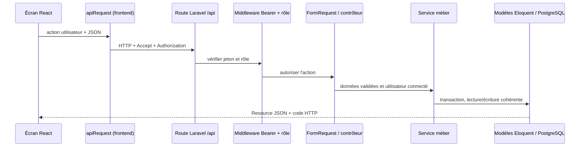

# Guide technique détaillé — Laravel, React, API et paiements

Ce guide explique les mécanismes réellement présents dans le dépôt. Il complète le [guide des neuf étapes](Guide_Backend_9_Etapes.md), la [documentation API](../api/API_Backend_Mon_Miam_Miam.md) et l'[inventaire PostgreSQL](../architecture/Migrations_PostgreSQL_Mon_Miam_Miam.md).

## 1. Comment une requête traverse l'application



### Rôle des couches Laravel

1. **Route** (`routes/api.php`) associe méthode HTTP, chemin, middleware et contrôleur.
2. **Middleware** bloque la requête si le jeton manque/est invalide ou si le rôle ne convient pas.
3. **Form Request** (`app/Http/Requests`) valide la forme et les règles simples des entrées; Laravel répond `422` si la validation échoue.
4. **Contrôleur** traduit HTTP en action métier, transmet l'utilisateur authentifié, choisit la réponse et son code HTTP. Il ne devrait pas calculer un prix à la place du service.
5. **Service** (`app/Services`) regroupe les règles métier réutilisables : états de commande, remise, points, annulation, authentification, paiement.
6. **Modèle Eloquent** représente une table et ses relations, scopes et casts.
7. **Resource** (`app/Http/Resources`) choisit les champs JSON exposés pour ne pas divulguer le hash du mot de passe ni les données internes.
8. **Migration** versionne la structure et les contraintes du schéma; **Seeder** insère les références et données de démonstration.

L'injection de dépendances est utilisée par constructeur, par exemple `PaiementController(PaiementService $paiements)`. Le conteneur Laravel instancie le service et ses dépendances. L'interface `PaiementGateway` rend le mode de paiement remplaçable sans réécrire le contrôleur.

## 2. Fonctions Laravel et PHP utilisées

| Fonction/API | Où et pourquoi |
|---|---|
| `Route::get/post/patch/put/delete`, `Route::middleware`, `Route::prefix` | Déclarer les endpoints, protéger les groupes et réduire les répétitions de préfixe |
| `FormRequest::rules()` / `$request->validated()` | Valider puis ne transmettre que les champs autorisés |
| `Request::user()` | Lire le compte déjà authentifié par `auth:api` |
| Route model binding (`Commande $commande`) | Charger une entité par son identifiant et retourner `404` si elle n'existe pas |
| Eloquent `create`, `update`, `fresh`, `with`, `where`, `whereKey`, `lockForUpdate` | Écrire, relire, charger les relations, filtrer et verrouiller les lignes concurrentes |
| Relations `belongsTo`, `hasMany`, `hasOne` | Naviguer entre utilisateur/étudiant/commande/lignes/paiement et éviter les jointures répétées |
| `DB::transaction(fn () => ...)` | Valider toutes les écritures ou les annuler ensemble si une règle échoue |
| `DB::table(...)` | Utiliser Query Builder pour quelques tables de pivot ou accès simples |
| `Hash::make`, `Hash::check` | Hacher les secrets et vérifier un mot de passe sans enregistrer sa version en clair |
| `Str::uuid`, `Str::random` | Créer des clés d'idempotence, jetons et valeurs aléatoires difficiles à deviner |
| `$request->validate`, `Validator::make` | Validation ponctuelle (notification agrégateur, anonymisation) |
| `abort_unless`, `firstOrFail`, exceptions métier | Arrêter avec un statut HTTP précis quand une ressource/règle ne convient pas |
| `Http::withToken()->post()` | Appel sortant REST de l'adaptateur agrégateur |
| `RateLimiter::for` / `throttle` | Limiter les tentatives de connexion, inscription, reset et jeux |
| `Mail::to()->send()` | Envoyer le lien de réinitialisation et les notifications de commande selon le mailer configuré |
| `now()`, `Carbon::parse()` | Contrôler dates, délais des commandes et expiration des sessions de jeu |
| `JsonResource` | Normaliser les réponses HTTP JSON et masquer les données privées |
| `ServiceProvider::register/bind` | Fournir le simulateur ou l'adaptateur selon `MOBILE_MONEY_MODE` |

### Services métier principaux

- `AuthService` : inscription, connexion, génération du parrainage, réinitialisation et révocation des jetons.
- `JetonService` : délivrer/vérifier/révoquer les jetons d'accès dont seule l'empreinte est stockée.
- `CatalogueService` : catalogue, menu du jour et composition du menu.
- `CommandeService` : calcul devis, prix du jour, création des lignes, transitions d'état, journal historique et annulation.
- `FideliteService`, `PointsService`, `ParametreService` : calculer les remises/gains, enregistrer chaque débit/crédit et lire les règles du restaurant.
- `PaiementService`, `RemboursementService` : créer et suivre une transaction, confirmer une commande et compenser les points/paiements lors d'une annulation.
- `PaiementSimuleGateway`, `PaiementAgregateurGateway` : implémentations de `PaiementGateway`.
- `JeuService` : créer une question non choisie par le navigateur, valider une réponse avec session expirante, calculer le score et attribuer les points côté serveur.
- `RestaurantService` : déterminer le contexte du restaurant pour les opérations de menu/commande.

### Fonctions de commande à connaître pour la soutenance

1. `CommandeService::chiffrer()` relit prix, disponibilité et promotions en base; le frontend n'envoie pas le prix.
2. `CommandeService::creer()` enregistre commande et lignes avec un prix appliqué figé et le commentaire de l'étudiant.
3. `CommandeService::confirmer()` recontrôle l'âge du panier, le menu, le stock et le solde de points; elle débite les points dans le grand livre.
4. `demarrer()`, `marquerPrete()`, `cloturer()` appliquent les transitions autorisées; `lockForUpdate()` empêche deux employés de traiter la même commande simultanément.
5. Chaque transition appelle `noter()` pour écrire dans `historique_commande` qui a changé l'état et quand.
6. `annuler()` écrit un mouvement de correction au lieu de réécrire l'historique des points; le remboursement suit `RemboursementService`.

## 3. React, Inertia et accès API

### Entrée Inertia

- `frontend/src/main.jsx` appelle `createInertiaApp`, résout les pages React, puis les monte avec `createRoot`.
- `backend/routes/web.php` renvoie la page `Application` via `Inertia::render`.
- `HandleInertiaRequests` partage les informations communes prévues par le middleware Inertia.
- `resources/views/app.blade.php` contient les directives `@vite`, `@inertiaHead` et `@inertia`.
- `frontend/src/inertia/Application.jsx` fournit l'application React existante à la page Inertia; React Router garde ses chemins actuels.
- Vite compile les sources React depuis `frontend/` vers `backend/public/build` grâce à `frontend/vite.config.js`.

### Hooks React utilisés

| Hook/fonction | Utilisation dans le projet |
|---|---|
| `useState` | État local du composant : formulaire, panier, consentement, menu et notifications |
| `useEffect` | Synchroniser le profil/menu au démarrage et écrire le panier dans `localStorage` |
| `useMemo` | Recalculer les lignes et totaux du panier uniquement quand panier/menu changent |
| `useCallback` | Stabiliser l'ajout de notification/toast partagé |
| `createContext`, `useContext` | Partager utilisateur, panier, actions et données de l'application à travers `AppProvider` |
| `useNavigate`, `Link` | Navigation React Router sans rechargement complet |
| `async` / `await` | Attendre l'API lors de connexion, profil ou commande et afficher les erreurs serveur |

`AppContext.jsx` joue le rôle de magasin applicatif simple. Il conserve encore certaines pages d'administration, jeux et réclamations avec les données de démonstration; les parties actuellement reliées à l'API sont explicitement listées dans le README et le guide d'installation. Il ne faut donc pas présenter tout l'état React comme déjà persistant dans PostgreSQL.

### Client API `frontend/src/services/api.js`

- `apiRequest(path, options)` forme l'URL (`VITE_API_URL`), ajoute `Accept: application/json`, sérialise le corps en JSON, ajoute le jeton Bearer si présent, lit la réponse et convertit les erreurs de validation en message affichable.
- `saveApiSession()` stocke le jeton et profil dans `sessionStorage`; si l'utilisateur demande à rester connecté, il utilise `localStorage`.
- `getApiToken()`, `readApiUser()`, `saveApiUser()` et `clearApiSession()` centralisent la session navigateur.
- `mapUtilisateur()` et `mapArticle()` adaptent les noms du schéma français Laravel au format attendu par les composants React.

Ces fonctions utilisent `fetch` du navigateur; aucune librairie HTTP supplémentaire (Axios) n'est requise. Le jeton est dans le stockage web local, donc une version de production plus sensible pourrait migrer vers des cookies `HttpOnly` après ajout d'une configuration CORS/CSRF appropriée.

## 4. Contrat des API et formats pratiques

Base locale : `http://127.0.0.1:8000/api`. Pour les requêtes privées, envoyer `Authorization: Bearer <jeton>` et `Accept: application/json`.

Exemple de connexion :

```http
POST /api/auth/connexion
Content-Type: application/json
Accept: application/json

{"email":"etudiant@ucac-icam.com","mot_de_passe":"Demo1234","se_souvenir":false}
```

Exemple de commande :

```json
{
  "mode_service": "sur_place",
  "heure_arrivee": "12:30",
  "commentaire": "Sans piment, s'il vous plaît",
  "utiliser_points": false,
  "lignes": [{"article_id": 1, "quantite": 2}]
}
```

Exemple d'initiation de paiement :

```json
{"telephone":"2376XXXXXXXX","operateur":"orange_money"}
```

Pour MTN, `operateur` vaut `mtn_momo`. Les erreurs Laravel sont normalement `422` avec `message` et `errors`; accès anonyme `401`; rôle refusé `403`; ressource absente `404`; conflit d'état/idempotence `409`. Le montant/prix n'est pas une donnée de confiance envoyée par le navigateur.

Les catégories de routes sont listées par verbes/chemins dans [API_Backend_Mon_Miam_Miam.md](../api/API_Backend_Mon_Miam_Miam.md). Utiliser `php artisan route:list --path=api` pour voir la liste exacte construite par Laravel.

## 5. Paiements Mobile Money, étapes et garanties

### Cycle normal

1. L'étudiant valide le panier : `CommandeService` crée l'état `panier` et les prix venant de la base.
2. Le frontend appelle `POST /commandes/{id}/paiement` avec téléphone et opérateur.
3. `PaiementController::initier()` vérifie utilisateur, rôle, commande et données.
4. `PaiementService::initier()` verrouille la commande, réutilise un paiement déjà en attente si possible, crée une clé UUID d'idempotence et une ligne `paiement` en état `en_attente` dans une transaction SQL.
5. Après commit, `PaiementGateway::initier()` déclenche la simulation ou l'appel HTTP de l'agrégateur. L'appel réseau se fait hors transaction SQL afin qu'une latence externe ne garde pas de verrou de base.
6. En réel, l'agrégateur appelle `POST /api/paiements/notification` avec une signature `X-MMM-Signature`. En simulation, le frontend local appelle `/paiements/{id}/simulation`.
7. Le contrôleur vérifie la signature/format; `PaiementService::traiterNotification()` verrouille paiement et commande, contrôle l'état et le montant confirmé.
8. Pour une réussite, la même transaction confirme la commande, actualise le paiement et crédite les points/prime de parrainage une fois. Une répétition d'une notification déjà traitée ne double pas les gains.

### Pourquoi `PaiementGateway` ?

`PaiementGateway` définit les méthodes que le service attend (`initier`, vérification de notification, remboursement). `PaiementSimuleGateway` respecte le contrat sans encaissement réel; `PaiementAgregateurGateway` encapsule HTTP REST, bearer d'accès et signature configurables. `AppServiceProvider` lie une implémentation selon `MOBILE_MONEY_MODE`. Ce patron d'adaptateur permet de remplacer l'intégration externe tout en conservant le calcul des points dans le domaine métier.

### Ce qui est requis avant un vrai paiement

Le mode par défaut est `simulation`. Un vrai déploiement exige fournisseur choisi, environnement sandbox, URL et version d'API officielles, marchand/clé, devise, signature et exemples de callbacks, délais/erreurs, protocole de remboursement, URL HTTPS publique et politique de rotation de secrets. La configuration `.env.example` ne contient que les noms de variables; les valeurs réelles restent dans `.env` ou un gestionnaire de secrets, jamais dans React ni dans Git.

L'adaptateur actuel illustre un contrat générique. Ne pas le déclarer compatible certifié Orange ou MTN avant adaptation aux spécifications du fournisseur qui sera réellement choisi.

## 6. Dépendances du projet

### Backend (`backend/composer.json`)

| Dépendance | Version déclarée | Usage |
|---|---:|---|
| PHP | `^8.2` | Langage serveur |
| `laravel/framework` | `^12.0` | Routes, conteneur, validation, Eloquent, sécurité, migrations |
| `inertiajs/inertia-laravel` | `^2.0` | Adaptateur serveur Inertia |
| `laravel/tinker` | `^2.10.1` | Console interactive de développement |
| `phpunit/phpunit` | `^11.5.50` (dev) | Tests automatisés |
| `fakerphp/faker`, `mockery/mockery` | dev | Données fictives et mocks de test |
| `laravel/pint`, `laravel/pail`, `collision` | dev | Formatage, logs locaux et affichage console |

Les versions installées exactes sont épinglées dans `backend/composer.lock`; Composer installe le verrou plutôt que de choisir de nouvelles versions à chaque poste.

### Frontend (`frontend/package.json`)

| Dépendance | Version déclarée | Usage |
|---|---:|---|
| `react`, `react-dom` | `^19.2.8` | Composants et rendu DOM |
| `@inertiajs/react` | `^2.0.0` | Adaptateur Inertia React |
| `react-router-dom` | `^7.18.4` | URL de la maquette et navigation SPA existante |
| `vite` | `^8.3.0` | Serveur de développement et build |
| `laravel-vite-plugin` | `^3.0.0` | Intégration des assets Vite à Laravel |
| `@vitejs/plugin-react` | `^6.1.1` | Compilation React par Vite |
| `tailwindcss`, `@tailwindcss/vite`, `daisyui` | versions dans `package.json` | Styles et composants/thème |
| `lucide-react` | `^1.56.0` | Icônes |
| `eslint` et plugins React | dev | Contrôle statique du frontend |

`package-lock.json` fixe les versions installées précises. Les outils système nécessaires restent PHP avec extensions, Composer, Node/npm et PostgreSQL.

## 7. Commandes terminal Windows / PowerShell

Dans un terminal PowerShell ouvert à la racine, créer les deux bases (PostgreSQL doit être démarré) :

```powershell
psql -U postgres -h 127.0.0.1 -p 5432 -c "CREATE DATABASE mon_miam_miam;"
psql -U postgres -h 127.0.0.1 -p 5432 -c "CREATE DATABASE mon_miam_miam_test;"
```

Ouvre un premier terminal PowerShell pour Laravel :

```powershell
cd backend
# Installer le backend depuis composer.lock
composer install

# Copier la configuration locale (ne pas committer le fichier .env)
Copy-Item .env.example .env
php artisan key:generate

# Éditer .env et vérifier DB_HOST, DB_PORT, DB_DATABASE, DB_USERNAME, DB_PASSWORD.
php artisan migrate:status
php artisan migrate --seed
php artisan serve
```

Dans un deuxième terminal PowerShell, depuis la racine du dépôt :

```powershell
cd frontend
npm ci
# Copier la configuration Vite si frontend/.env n'existe pas encore.
if (-not (Test-Path .env) -and (Test-Path .env.example)) { Copy-Item .env.example .env }
npm run dev
```

Ouvrir l'URL affichée par `artisan serve` (habituellement `http://127.0.0.1:8000`). Vite écoute habituellement `http://localhost:5173`; avec la configuration Inertia, c'est Laravel qui sert la page et Vite fournit les assets en mode développement.

### Commandes utiles à la soutenance

```powershell
# Toujours depuis backend/
php artisan route:list --path=api
php artisan migrate:status
php artisan db:seed --class=ReferenceSeeder
php artisan db:seed --class=DemoSeeder
php artisan test

# Toujours depuis frontend/
npm run lint
npm run build
```

`DemoSeeder` utilise des comptes de démonstration avec mot de passe connu : ne jamais conserver ces comptes en production. Ne lancer `DemoSeeder` que dans la base locale souhaitée.

### Extensions PHP à contrôler sur Windows

```powershell
php --version
php --ini
php -m | Select-String 'PDO|pgsql|mbstring|openssl|curl|fileinfo|xml|zip'
```

Dans le `php.ini` indiqué par `php --ini`, activer les extensions requises par le projet et PostgreSQL (notamment `pdo_pgsql` et `pgsql`), puis fermer/réouvrir le terminal et revérifier `php -m`. Le test récent de ce dépôt s'est arrêté sur `PDOException: could not find driver`, donc le code PHP est présent mais le runtime utilisé doit être équipé de `pdo_pgsql` avant que les tests PostgreSQL puissent réussir.

## 8. Dépannage courant

| Symptôme | Cause à vérifier | Action |
|---|---|---|
| `could not find driver` | `pdo_pgsql` absent de la version PHP CLI | Contrôler `php --ini`, activer `pdo_pgsql`, rouvrir le terminal |
| `relation ... does not exist` | Migration absente, mauvaise base ou mauvais `search_path` | Regarder `.env`, `migrate:status`, exécuter migrations sur la bonne base |
| `25P02 transaction is aborted` | Une requête précédente a échoué dans la transaction | Exécuter `ROLLBACK;` dans DataGrip/pgAdmin puis corriger la première erreur avant relance |
| `401` | Jeton manquant, expiré ou révoqué | Se reconnecter et vérifier l'en-tête `Authorization` |
| `403` | Rôle sans droit pour l'endpoint | Se connecter avec le compte de rôle prévu; vérifier le groupe middleware |
| Vite ne trouve pas `manifest.json` | Build pas fait ou répertoire de build incorrect | Lancer `npm run build` et vérifier le `buildDirectory` du plugin Laravel |
| Paiement bloqué en attente | Simulation désactivée ou callback absent | Pour la démonstration, garder `MOBILE_MONEY_MODE=simulation`; pour réel, valider URL/signature/callback du fournisseur |

## 9. Limites fonctionnelles à garder visibles

- Le build React et ESLint ont été vérifiés dans la copie préparée; les 138 fichiers PHP passent `php -l`.
- Les tests PHPUnit sont présents mais n'ont pas été exécutés jusqu'au bout avec succès dans cet environnement faute de pilote `pdo_pgsql`; le rapport observé est donc une erreur d'environnement, pas une preuve que les 191 cas métier passent.
- Certaines pages frontend restent branchées sur les données de démonstration. Vérifier les appels réellement présents dans `AppContext.jsx` avant d'annoncer une fonction comme persistée en base.
- Aucun encaissement réel, callback externe ou remboursement opérateur n'a été testé sans compte sandbox fournisseur.
- Le projet ne comporte actuellement ni vue SQL ni trigger PostgreSQL; consulter le document des migrations pour les raisons et les alternatives.
